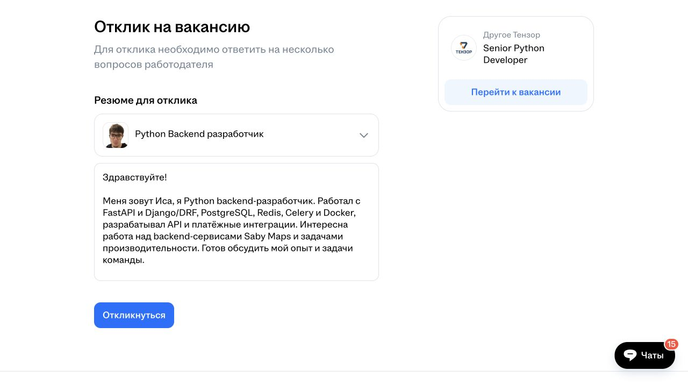

# Проверка формы отклика через браузер

Проверено 19 октября 2026 года в авторизованной сессии пользователя. Поиск, чтение вакансии, выбор нужного резюме и заполнение письма доступны через обычный интерфейс hh.ru. Кнопка отправки не нажималась. Отправка, возможная анкета и подтверждение результата остаются непроверенными.

Дополнение от 21 октября: отдельный реальный отклик на другую вакансию отправлен и подтверждён в истории; [отчёт](2026-10-21-hh-first-application.md). Ниже сохранены наблюдения первоначальной проверки без отправки.

## Вакансия и поиск

В поиске отображались фильтры Python, удалённо, указан доход, от 150 000 ₽. В момент проверки сайт показал 270 вакансий. Это результат одного запроса, а не полный охват согласованных правил: вакансии без зарплаты требуют отдельного поиска.

Для формы выбрана [Senior Python Developer в Тензоре](https://hh.ru/vacancy/134583271), ID `134583271`, работодатель `67611`. Указаны от 250 000 ₽ в месяц на руки, опыт 3–6 лет и возможность удалённой работы. Python входит в основные требования. Обязательные командировки в прочитанном описании не указаны. На странице была кнопка «Откликнуться», а не подтверждение существующего отклика; история откликов отдельно не проверялась.

До этого прочитана вакансия Techno Diasoft `137921356`: несмотря на отметку удалённой работы, в тексте есть ограничение Москвой/МО. Для проверки формы выбрана другая вакансия. Этот пример показывает необходимость читать условия внутри описания.

## Наблюдаемая последовательность

1. Кнопки «Откликнуться» на странице вакансии имеют роль `button`, атрибут `data-qa="vacancy-response-link-top"` и ссылку `/applicant/vacancy_response?vacancyId=134583271&employerId=67611&hhtmFrom=vacancy`.
2. Открыта именно наблюдаемая ссылка. Появилась отдельная страница «Отклик на вакансию». Поведение обработчика клика на карточке вакансии отдельно не тестировалось.
3. По умолчанию выбрано «Python Backend разработчик». В раскрытом списке три резюме; у выбранного radio-поля значение `b424f687ff113123eb0039ed1f7a496e413267`, совпадающее с резюме пользователя. Названия двух резюме похожи, поэтому будущий сценарий должен проверять идентификатор.
4. Кнопка «Сопроводительное письмо Добавить» раскрывает `textarea` с `data-qa="vacancy-response-popup-form-letter-input"`.
5. Вставлено письмо длиной 291 символ. Текст и переносы подтверждены интерфейсом. При фокусе показан счётчик «291 из 10000». HTML-атрибуты `maxlength` и `required` отсутствуют; проверка предельной длины и отправки пустого письма не выполнялась.
6. В форме есть отдельная кнопка «Откликнуться» с `type="submit"` и `data-qa="vacancy-response-submit-popup"`. Кнопка доступна для нажатия, но не нажималась. Нельзя считать доказанным, что этот шаг сразу завершает отклик.

На странице есть текст «Для отклика необходимо ответить на несколько вопросов работодателя», однако сами вопросы до отправки не отображались. Наличие и порядок следующего шага требуют отдельной проверки.

## Видимость резюме: уточнение наблюдения

Дерево доступности включило текст о необходимости сделать резюме видимым всем работодателям. Снимок страницы показал, что предупреждение не отображается. Проверка соответствующего DOM-элемента установила: блок `data-qa="hidden-resume-warning"` свёрнут, `max-height: 0px`.

На странице самого выбранного резюме указано «Видно всем работодателям, зарегистрированным на hh.ru». Настройки не менялись. Скрытый текст нельзя использовать как признак блокировки формы; нужно проверять фактическое отображение предупреждения.

## Черновик в форме

> Здравствуйте!
>
> Меня зовут Иса, я Python backend-разработчик. Работал с FastAPI и Django/DRF, PostgreSQL, Redis, Celery и Docker, разрабатывал API и платёжные интеграции. Интересна работа над backend-сервисами Saby Maps и задачами производительности. Готов обсудить мой опыт и задачи команды.

В этом черновике использованы факты резюме; дополнений о неподтверждённых технологиях нет. Письмо не отправлялось. Вкладка оставлена открытой с заполненной формой; сохранение черновика после перезапуска не проверено.

## Граница результата

Подтверждено управление формой через браузер в текущей сессии. Это ещё не автономный агент: программа поиска, очередь, Telegram и управление отдельной постоянной сессией не реализованы. Не проверены отправка, анкеты после кнопки, подтверждение отклика, история и предотвращение повторной отправки. Наблюдения одной формы не гарантируют одинаковый порядок действий у всех вакансий.
