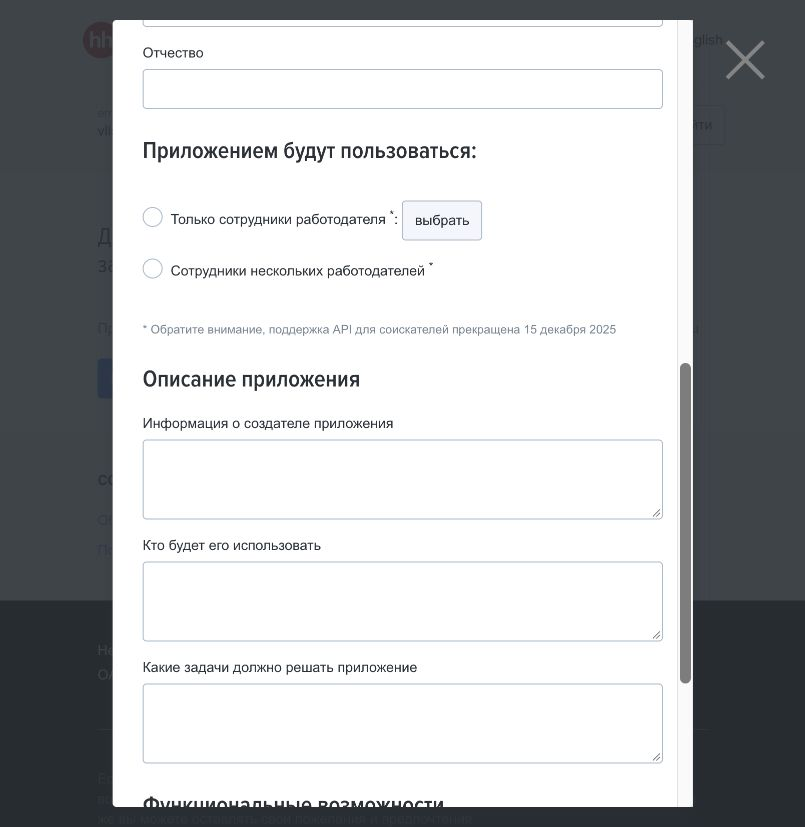

# Проверка подключения к hh.ru

Проверено 19 октября 2026 года. Официальный API больше не поддерживает приложения для соискателей. Через обычный сайт после входа пользователя его резюме доступно. Автоматическая отправка откликов через сайт в этой проверке не выполнялась.

Дополнение от 21 октября: в отдельной проверке отправлен один отклик через браузер, подтверждены история и письмо в чате. См. [результат первого отклика](2026-10-21-hh-first-application.md). Описанные ниже ограничения относятся к исходной проверке 19 октября.

В тот же день [API проверен повторно](2026-10-21-hh-api-recheck.md). Уточнение: ограничение касается поддерживаемой отправки откликов новым приложением соискателя, а не всего API. Поиск и просмотр вакансий остаются документированными; анонимные запросы из нашего окружения снова вернули 403, справочники — 200.

## Прямое подтверждение в кабинете разработчика

После самостоятельного входа пользователя в [кабинет разработчика](https://dev.hh.ru/admin) открыта форма «Регистрация нового приложения». В ней показано сообщение:

> Обратите внимание, поддержка API для соискателей прекращена 15 декабря 2025

Варианты аудитории приложения: «Только сотрудники работодателя» и «Сотрудники нескольких работодателей». Варианта для соискателя нет. Зарегистрированных приложений в кабинете не отображается; предлагается подать заявку.

Форма не отправлялась. Приложение работодателя вместо приложения соискателя не регистрировалось.

## Что подтвердили запросы только на чтение

Запросы выполнялись с заголовком клиента, без токенов и без использования браузерных cookies.

| Проверка | Результат | Значение |
| --- | --- | --- |
| GET /dictionaries | HTTP 200 | Общедоступный справочник читается |
| GET /areas | HTTP 200 | Справочник регионов читается; связь с API работает |
| GET /vacancies?text=python&per_page=1 | HTTP 403, forbidden | Анонимный поиск из текущего окружения недоступен |
| GET /me | HTTP 403, forbidden | Информация аккаунта без токена не получена |
| GET /resumes/mine | HTTP 403, forbidden | Собственные резюме через этот запрос не получены |
| GET /negotiations | HTTP 403, forbidden | Отклики через этот запрос не получены |

Сам по себе ответ 403 не доказывает удаление метода. Вывод о прекращении соискательского API основан на прямом уведомлении в кабинете, а не на этих ошибках.

В описании поиска сказано, что без токена после первого запроса предлагается капча. Поэтому наличие метода поиска в документации не подтверждает возможность длительного анонимного сбора вакансий.

## Текущий контракт API и история

Скачана [публичная спецификация OpenAPI](https://api.hh.ru/openapi/specification/public):

- GET /vacancies и GET /me присутствуют.
- У /negotiations описан только GET, а POST для отправки соискательского отклика отсутствует.
- /resumes/mine отсутствует среди маршрутов. Упоминание этой строки в примере профиля не является описанием поддерживаемой операции.
- Операция apply-to-vacancy отсутствует.

Официальное [изменение README](https://github.com/hhru/api/commit/238d17b3cdb738bf924c407abd515ba40989cae3) также удаляет ссылки на собственные резюме и отклики соискателя. Точную дату прекращения поддержки подтверждает уведомление в кабинете.

Сводка запросов и контрольная сумма скачанной спецификации сохранены в [результатах проверки](2026-10-19-hh-api-probe.json). В них нет токенов, cookies и контактных данных пользователя.

## Обычный сайт и дальнейший путь

В том же браузере после входа открыта предоставленная пользователем страница резюме. Видны его содержание и действия владельца, в том числе редактирование и переход к откликам. Это подтверждает, что текущая браузерная сессия имеет доступ к аккаунту соискателя.

Это не является подключением автономного агента. Сессия не экспортировалась; устойчивость входа после перезапуска, отправка и чтение ответов ещё требуют отдельных проверок. В последующей проверке того же дня подтверждены поиск через браузер и заполнение формы отклика с нужным резюме; кнопка отправки не нажималась. Подробности — в [отчёте о браузерной форме](2026-10-19-hh-browser-form.md).

Для полной цели проекта остаётся проверить отправку через обычный интерфейс hh.ru, возможные анкеты и подтверждение результата. Официальный API больше не рассматривается как основной способ автооткликов для этого аккаунта.

Во время проверки не изменялись резюме и настройки аккаунта, не отправлялись отклики и сообщения работодателям, не запрашивались дополнительные права приложения.
