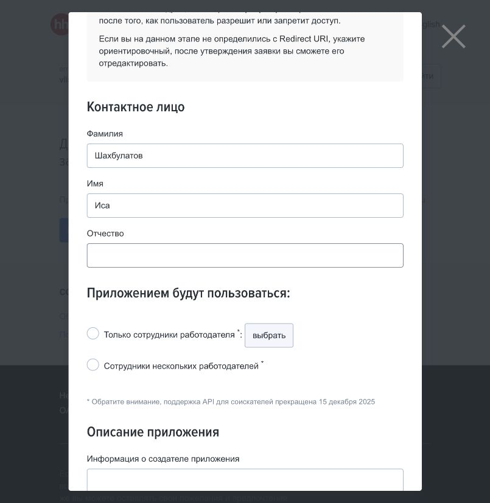

# Повторная проверка официального API hh.ru

Дата: 21 октября 2026 года, по часовому поясу пользователя Asia/Bangkok.

Вывод: нельзя утверждать, что API hh.ru вообще недоступен. Поиск и чтение вакансий остаются документированными методами, а справочники доступны в проверенном окружении. Однако поддерживаемый способ отправки откликов от имени соискателя для нового личного приложения не найден: кабинет прямо сообщает о прекращении поддержки, а текущий публичный контракт не содержит метода отправки такого отклика.

## Новая проверка кабинета разработчика

Страница [dev.hh.ru/admin](https://dev.hh.ru/admin) перезагружена в авторизованной сессии пользователя. Открыта форма регистрации нового приложения. В ней снова показано:

> Обратите внимание, поддержка API для соискателей прекращена 15 декабря 2025

Для аудитории доступны только сотрудники одного работодателя или нескольких работодателей. В кабинете по-прежнему предлагается зарегистрировать приложение; существующего приложения для получения собственного OAuth-токена нет. Форма не заполнялась и не отправлялась.

## Текущая публичная спецификация

Повторно скачана [официальная спецификация](https://api.hh.ru/openapi/specification/public): 1 322 029 байт UTF-8, 1 092 832 символа, SHA-256 `c465d0a45c61ad282f9627d09a927296700d1748e792aa72cb581481a063121e`. Содержимое совпадает с контрольной суммой предыдущей проверки.

| Возможность | Что описано в контракте |
| --- | --- |
| Поиск вакансий | `GET /vacancies`, операция `get-vacancies` |
| Чтение вакансии | `GET /vacancies/{vacancy_id}`, операция `get-vacancy` |
| OAuth и профиль | `/token` и `GET /me` присутствуют; упоминания соискателя остаются |
| Собственные резюме | `/resumes/mine` отсутствует среди маршрутов |
| Отправка отклика соискателем | `POST /negotiations` и операция `apply-to-vacancy` отсутствуют |
| Список откликов | У `/negotiations` есть только `GET`; описание говорит о коллекциях по вакансии работодателя, хотя теги ещё упоминают соискателя |

Среди остальных маршрутов откликов есть отправка сообщения в существующую переписку, отметка прочтения, смена состояния и приглашение кандидата работодателем. Это не методы создания отклика соискателя.

Наличие OAuth, профиля и старых тегов не означает наличие поддерживаемого доступа к отправке отклика. [Коммит официального репозитория от 17 декабря 2025 года](https://github.com/hhru/api/commit/238d17b3cdb738bf924c407abd515ba40989cae3) удалил из README ссылки на собственные резюме, соискательскую переписку и отклик на вакансию. Дату 15 декабря подтверждает уведомление в кабинете, а не дата этого коммита.

Извлечённые маршруты и операции: [результат чтения контракта](2026-10-21-api-contract.json).

## Новые HTTP-проверки

Выполнены только публичные GET-запросы, без токенов, браузерных cookies и данных аккаунта, с идентифицирующим заголовком клиента.

| Запрос | Результат |
| --- | --- |
| `/vacancies?text=python&per_page=1` | 403, `forbidden` |
| `/vacancies/137924141` | 403, `forbidden` |
| `/dictionaries` | 200, получены справочники |
| `/openapi/specification/public` | 200, получена спецификация |

Ответы 403 подтверждают только недоступность этих анонимных запросов в данном окружении. Они не доказывают отключение поиска для всех клиентов и не являются проверкой отправки отклика с действующим OAuth-токеном. Причина этих 403 из ответа сервера не определена. В описании поиска отдельно сказано, что без токена после первого запроса предлагается капча.

Первый запуск запросов внутри ограниченной среды завершился ошибкой DNS; это ограничение окружения. После разрешённого сетевого доступа получены HTTP-ответы выше. [Сводка сетевой проверки](2026-10-21-api-recheck-probe.json) содержит только результаты, без секретов.

## Граница уверенности и решение для проекта

- Официальное прекращение поддержки соискательского API подтверждено непосредственно в кабинете hh.ru после перезагрузки.
- Поиск через API технически предусмотрен документацией. Гибрид «API для поиска, браузер для отклика» можно рассматривать, если будет получен разрешённый и работающий доступ к поиску; сейчас такой доступ у проекта не подтверждён.
- Для автоматических откликов нового личного приложения поддерживаемого официального пути не найдено. Работодательская регистрация не является заменой соискательской.
- Действующего старого токена у проекта нет. Работоспособность всех старых клиентов, частных партнёрских соглашений и внутренних запросов сайта не проверялась; их техническую невозможность этот отчёт не утверждает. Документированного исключения для нашего сценария не найдено.
- Ни новый отклик, ни сообщение в поддержку при этой проверке не отправлялись. Ранее подтверждённый браузерный путь остаётся рабочим вариантом для отправки.
