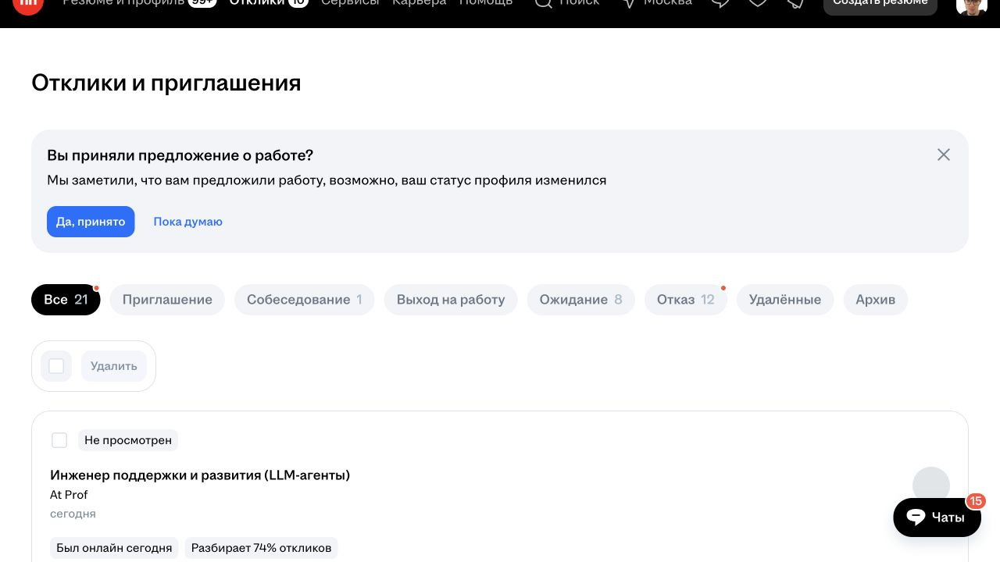

# Первый подтверждённый отклик через браузер

Дата проверки: 21 октября 2026 года (дата пользователя, Asia/Bangkok).

Результат: отправлен один реальный отклик с сопроводительным письмом. hh.ru показал «Вы откликнулись»; запись найдена в истории, а полный текст письма — в чате вакансии. Статус на момент проверки: «Не просмотрен». Тесты не предлагались и не проходились.

## Вакансия и выбранное резюме

- [Инженер поддержки и развития (LLM-агенты)](https://hh.ru/vacancy/137924141), At Prof.
- ID вакансии: `137924141`; ID работодателя: `2767410`.
- Зарплата: от 200 000 ₽ в месяц на руки. Разрешена удалённая работа, Python явно указан в требованиях. Обязательные командировки в прочитанном описании не указаны.
- Выбранное резюме: «Python Backend разработчик», ID `b424f687ff113123eb0039ed1f7a496e413267`. Значение и выбранное состояние radio-поля проверены до отправки.
- Перед действием вакансия не отображалась среди 20 записей вкладки «Все» в истории. Архив и удалённые отклики отдельно не проверялись. На странице вакансии была кнопка «Откликнуться», без отметки о предыдущем отклике.

## Проверенная последовательность

1. Прочитаны условия вакансии; открыта ссылка формы из кнопки «Откликнуться».
2. Проверено резюме, раскрыто поле письма, вставлены 616 символов с переносами строк.
3. На странице и в форме отсутствовало видимое предложение пройти тест. В форме присутствовал общий текст «Для отклика необходимо ответить на несколько вопросов работодателя»; он сам по себе не подтверждает наличие теста.
4. Кнопка формы «Откликнуться» нажата один раз. Во время обработки она стала недоступна и показала индикатор загрузки.
5. После завершения появилось «Вы откликнулись» и кнопка «Чат». Анкета и тест не появились. Отдельное предложение уточнить город поиска не заполнялось.
6. История обновлена: появилась новая запись именно вакансии `137924141`, At Prof, «сегодня», статус «Не просмотрен». Число записей вкладки «Все» увеличилось с 20 до 21.
7. Через «Перейти в чат» открыта переписка этой вакансии. Под меткой «Отклик на вакансию» прочитан полный отправленный текст; он совпадает с подготовленным письмом. Отдельные сообщения в чат не отправлялись.

## Отправленное письмо

Здравствуйте!

Меня зовут Иса, я Python backend-разработчик. В FitStars разрабатывал асинхронный backend на FastAPI для AI-приложения: интегрировал GPT/Vision, реализовал контекстный AI-чат, валидацию структурированных ответов и guardrails. Работал с MongoDB и Redis.

В финтех-проектах разрабатывал API и интеграции с внешними системами, использовал PostgreSQL, Celery и Docker, настраивал CI/CD и развёртывание через Nginx.

Интересны задачи поддержки и развития вашей платформы: разбор поведения LLM, отладка интеграций и улучшение backend-процессов. Рассматриваю удалённую работу и готов обсудить задачи команды.

Письмо использует факты предоставленного резюме. Неподтверждённые утверждения не добавлялись. [Снимок чата](2026-10-21-first-application-letter.jpg) показывает нижнюю часть письма; весь текст проверен через доступное содержимое интерфейса.

## Наблюдение для защиты от повторной отправки

После успеха форма осталась открытой, выбранное название резюме изменилось на похожее «Python Backend-разработчик», а кнопка — на «Откликнуться повторно». Она не нажималась. Будущий сценарий должен завершать отправку после подтверждения, сохранять ID вакансии и игнорировать возможность повторного отклика с другим резюме.

Общий текст про вопросы работодателя в этой форме не привёл к дополнительным вопросам. Нельзя считать этот текст доказательством теста или гарантировать такое же поведение у других вакансий. При явном предложении теста действует согласованное правило пропуска.

## Граница проверки

Подтверждён полный путь одного отклика в текущей браузерной сессии: вакансия → нужное резюме → письмо → отправка → история → письмо в чате. Это проверка возможностей интерфейса, а не запуск готового автономного приложения. Telegram, планировщик и очередь ещё не реализованы. Массовая отправка не запускалась.
